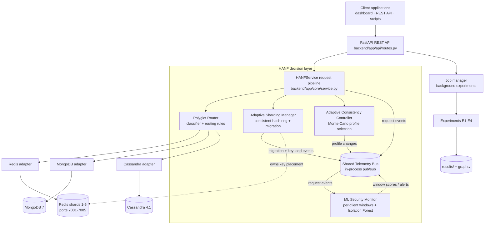
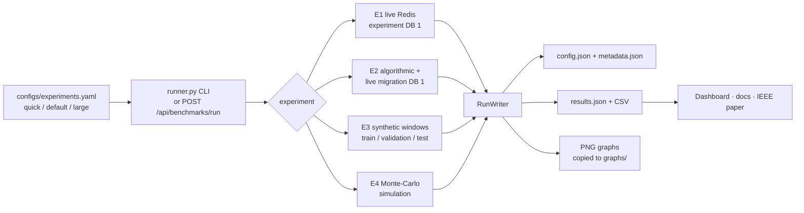

# HANF architecture

HANF (Hybrid Adaptive NoSQL Framework) is a middleware decision layer that sits between client
applications and several NoSQL engines. It makes four kinds of decision for every request — which
engine, which shard, which consistency level, and whether the client's behaviour looks anomalous —
and records every decision on a shared telemetry bus so the decisions can inform each other and be
shown on the dashboard.

## 1. Components



| Component | Code | Responsibility |
|---|---|---|
| REST API | `backend/app/api/routes.py`, `models/schemas.py` | Input validation (Pydantic), HTTP status codes, exports, job submission |
| Request pipeline | `backend/app/core/service.py` | Runs one request through router → ring → consistency → adapter → telemetry |
| Polyglot Router | `backend/app/router/` | Weighted-rule workload classifier; engine selection; fallback policy |
| Adapters | `backend/app/adapters/` | One interface (`StorageAdapter`) for Redis, MongoDB, Cassandra; honest health reporting |
| Adaptive Sharding Manager | `backend/app/sharding/` | Hash ring with virtual nodes; add/remove shards; verified migration; load-based re-weighting |
| ML Security Monitor | `backend/app/security/` | Feature windows, Isolation Forest, static-rule baseline, async/batched scoring, triage |
| Adaptive Consistency Controller | `backend/app/consistency/simulator.py` | Quorum latency/staleness model, profile selection under an SLO, timeline experiment |
| Telemetry Bus | `backend/app/telemetry/bus.py` | Timestamped events, subscribers, derived metrics, retention |
| Experiments | `backend/app/experiments/` | E1–E4 implementations, result store, graph generation, CLI runner |
| Dashboard | `frontend/` | Plain HTML/CSS/JS + Chart.js (vendored); every control calls the API |

## 2. Request lifecycle

```mermaid
sequenceDiagram
    participant Cl as Client
    participant API as REST API
    participant Pi as Pipeline
    participant Ro as Router
    participant Ri as Hash ring
    participant Co as Consistency ctl.
    participant Ad as Adapter
    participant Bus as Telemetry bus
    participant Mo as Security monitor
    Cl->>API: POST /api/requests/execute
    API->>API: validate (operation, key, value size, client_id)
    API->>Pi: execute(...)
    Pi->>Ro: classify + route
    Ro-->>Pi: workload, scores, reasons, engine (or fallback)
    Pi->>Co: level_for(operation)
    Co-->>Pi: ONE / QUORUM / ALL
    Pi->>Ad: Operation(op, key, value, level)
    Ad->>Ri: shard_for(key) (Redis only)
    Ad-->>Pi: ExecResult(status, data, meta)
    Pi->>Bus: publish("request", latency, shard, status, bytes, injection signal, ...)
    Bus->>Mo: on_request_event (if client_id)
    Mo->>Mo: append to client window; queue full windows; score (sync / batched / async)
    Pi-->>API: result + routing + shard + consistency + security info
    API-->>Cl: JSON response
```

Outcomes such as `not_found`, `denied` (failed login) and `rejected` (operator-injection on the
document engine) are normal results returned with HTTP 200. Invalid requests return 422,
an unavailable engine with no fallback returns 503, unexpected errors return 500 with a message.

## 3. Algorithms

### 3.1 Workload classification (Polyglot Router)
A deterministic weighted-rule scorer over three classes (key-value, document, wide-column). Rules
(weights in `configs/routing.yaml`): explicit hint (+10), operations that exist on only one engine
(`scan`/`login` → key-value +6, `query` → document +6), key prefix lists (+3), scalar value (+2 KV),
nested object/array (+2.5 document), flat object (+1 document), object with clustering field
`ts`/`ck` (+3.5 wide-column), payload > 1 KiB (+0.5 document), tie-breaker (+0.5 KV). The winning
class maps to an engine; confidence = winning score / total. If that engine is unavailable and the
operation exists on the key-value engine, the request falls back to Redis and the response says so.
This is an explainable rule system, not a learned model.

### 3.2 Consistent hashing and adaptive sharding
Keys and virtual-node tokens are hashed with MD5 (first 64 bits). A key belongs to the first token
clockwise. Adding a node to an N-node ring moves ≈ 1/(N+1) of the keys, all onto the new node.
Load-based re-weighting uses the rule from Review II:
`v_i ← max(16, round(v_i · (1 − 0.5 · (load_i / mean_load − 1))))`.

**Migration protocol** (per key whose owner changes): `DUMP` + `PTTL` on the source → `RESTORE`
on the destination *without* replace → verify the destination `DUMP` is byte-identical → delete the
source copy. If the destination already holds a different value, it was written after the ring
switched (writes always go to the new owner), so it is kept. During migration reads fall back to the
previous owner; failed keys stay on the source and `retry` finishes the job. The topology
(active shards, vnode weights, epoch) is persisted to `data/runtime/topology_<mode>.json`.

### 3.3 Security monitoring
Per client, every 100 consecutive requests form a window summarised by six features: request rate,
key diversity, mean payload bytes, failure ratio, injection-pattern ratio, scan ratio. Features are
z-scored with the training mean/std and scored by an Isolation Forest (100 trees) trained only on
normal synthetic windows; the alert threshold is the training-score quantile implied by the
contamination parameter (overridable). Static rules (injection > 0.2, failure > 0.5, scan > 0.5,
rate > 150/s) run alongside as a baseline. Explanations list the features with the largest |z|
(a deviation summary, not a causal attribution). Scoring modes: `sync`, `batched` (20 windows per
call), `async` (background worker) and `off`. The model file is stored with a SHA-256 sidecar and
refused if the checksum or feature list does not match.

### 3.4 Adaptive consistency
Three replicas in regions A, B, C; writer in A, reader in B. Sampled RTT = base × congestion (remote
links) × LogNormal(0, σ). Write latency = W-th smallest writer RTT. A read starts Exp(15 ms) after the
acknowledgement, contacts the R replicas closest to the reader and returns after the slowest one.
It is stale if none of them had applied the write (one-way delay) when the read arrived. The
controller estimates mean latency and stale probability of seven (W, R) profiles by Monte-Carlo and
chooses the fastest profile with predicted staleness ≤ SLO (default 1 %), else ALL/ALL. This follows
the probabilistic-staleness idea of Bailis et al. (PBS).

## 4. Shared telemetry model

Every event: `{id, ts, type, source, data}`. Main types:

| Type | Publisher | Key fields |
|---|---|---|
| `request` | pipeline | client_id, client_ts, operation, key, engine, workload, fallback, shard, status, latency_ms, payload_bytes, injection_signal, consistency_level, synthetic_label |
| `shard_migration_started/finished` | sharding | epoch, action, moved, failed, totals, remapped_pct |
| `security_window_scored`, `security_alert` | security | window id, client, verdict, score, top feature |
| `security_model_trained/ready/error` | security | contamination, threshold, checksum |
| `consistency_profile` | consistency | profile, levels, congestion estimate, SLO, fallback, trigger |
| `adapter_health` | router | adapter, status, verified_round_trip |
| `seed`, `synthetic_traffic` | service | counts |

Retention: newest 5,000 events in a ring buffer (`HANF_TELEMETRY_MAX_EVENTS`), latency percentiles
over the last 2,000 requests, cumulative counters until `POST /api/telemetry/reset`. Dashboard tiles
show where each metric comes from (the ⓘ tooltip, from `metric_sources`). Experiment results are
persisted to `results/`, not to the bus.

## 5. Benchmark workflow



Experiments that touch Redis use logical DB 1 (`HANF_EXPERIMENT_DB`) and flush it afterwards, so
the demo data in DB 0 is never affected. API-triggered runs are executed one at a time by a
single-worker job manager so they cannot distort each other.

## 6. Failure handling

| Situation | Behaviour |
|---|---|
| Redis shard unreachable at startup | `/health` = degraded; the shard row shows `down`; requests mapped to it fail with status `error` |
| Spare shard down when adding it | `add_shard` pings first and returns HTTP 503 without changing the ring |
| Destination fails mid-migration | Batch counted as failed, source copy kept, previous ring kept for read fallback, status `partial`; `retry` completes it |
| MongoDB/Cassandra down | Adapter status `unavailable` with the driver error; router falls back to Redis (flagged) or returns 503 |
| Security model missing/corrupt | Checksum check fails → model retrained from synthetic data in the background |
| Subscriber exception on the bus | Counted (`subscriber_errors`) and logged, never propagated to the request |
| Long experiment from the UI | Runs as a background job; the UI polls `/api/jobs/{id}` |

## 7. Design trade-offs

* **In-process telemetry bus instead of Kafka** — enough for one middleware process and keeps the
  demo to one command; a multi-instance deployment would need an external bus.
* **Rule-based classifier** — transparent and testable; a learned classifier would need labelled
  query logs that the project does not have.
* **Simulated consistency** — the demo machine cannot host a real multi-region cluster; the
  Cassandra adapter shows that the chosen level is applied to real statements, but on RF = 1.
* **Synthetic security data** — no real labelled NoSQL attack log was available.
* **Plain JS dashboard** — no build step; the trade-off is less component reuse than React.
* **Python middleware** — easy to read and extend, but each request costs tens of microseconds of
  interpreter time (measured in E1).

## 8. Current limitations
See [KNOWN_LIMITATIONS.md](KNOWN_LIMITATIONS.md).
