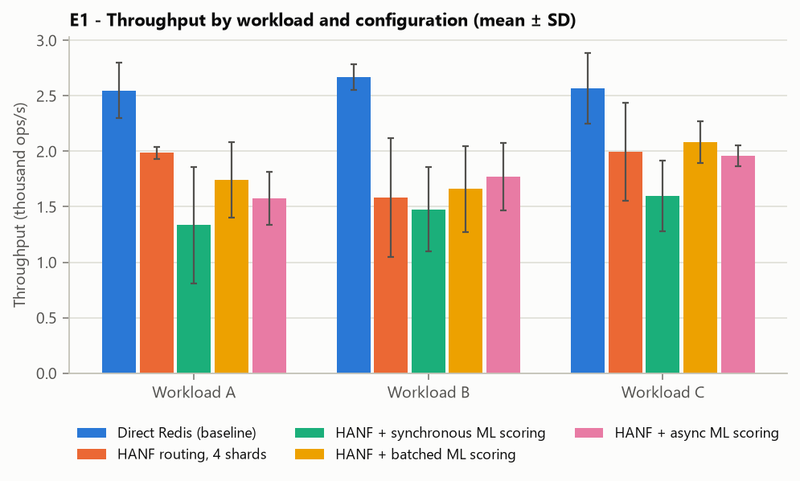
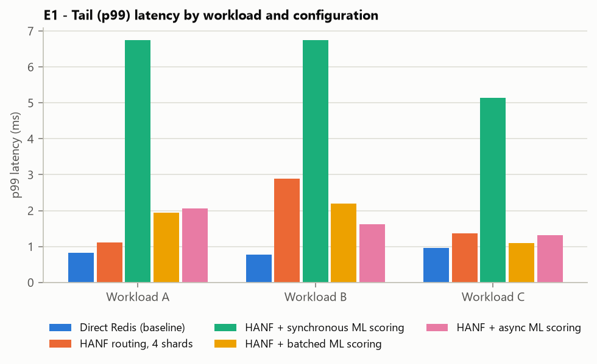
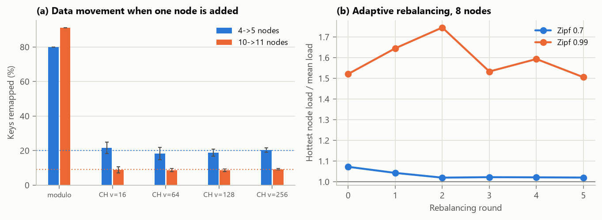
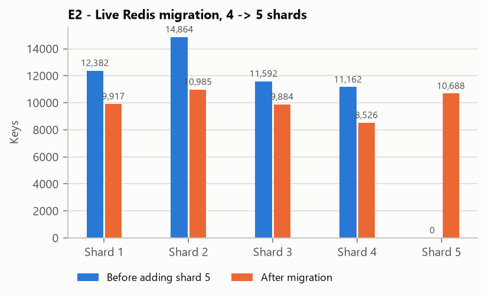
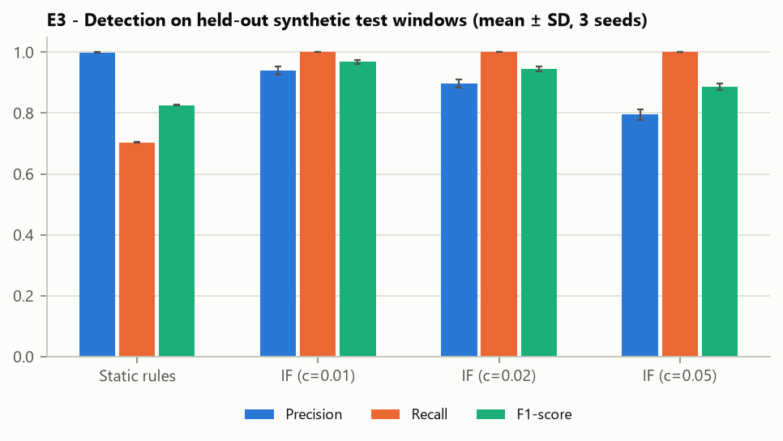
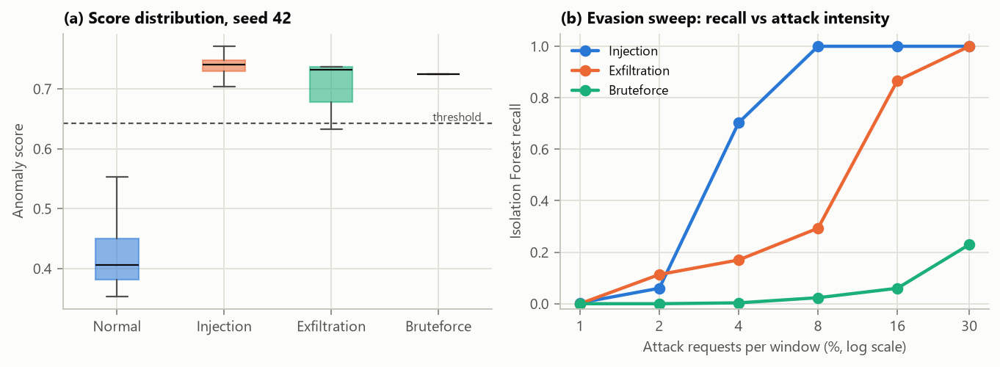
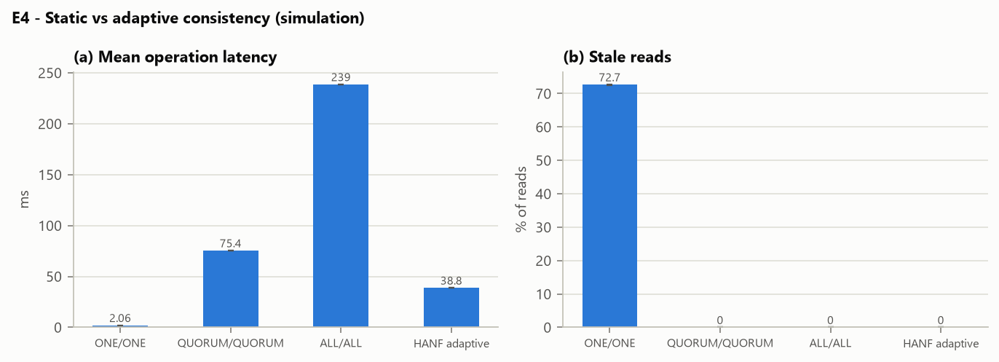
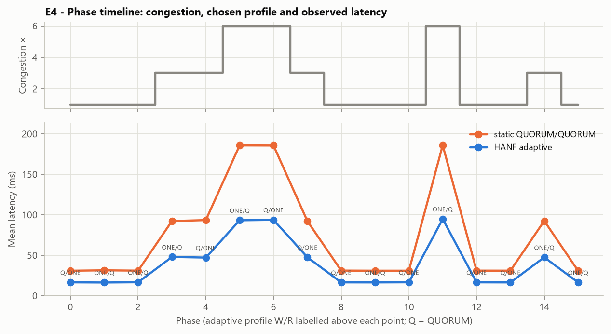
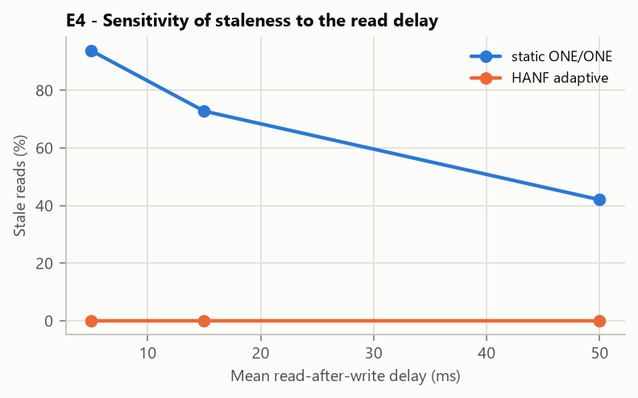

# Experiments and results

*Generated by `reports/build_report.py` on 2026-10-18 22:11 from the result files of the runs listed below. Do not edit numbers by hand — re-run the experiments and the builder instead.*

## Runs used
| Experiment | Run id | Profile | Evidence | Duration (s) |
|---|---|---|---|---|
| E1 | e1-20261018-205910-e7d3a6 | default | live Redis measurement | 539.59 |
| E2 | e2-20261018-210810-c9659d | default | algorithmic simulation + live Redis migration | 8.56 |
| E3 | e3-20261018-210819-f4d63d | default | synthetic-data evaluation | 49.04 |
| E4 | e4-20261018-210908-95be49 | default | simulation (no live multi-region cluster) | 2.62 |

Each run's full output (config.json, metadata.json, results.json, CSV tables, PNG graphs) is copied to `reports/data/<run_id>/`; the originals are in `results/<experiment>/<run_id>/`.

## Environment
| Item | Value |
|---|---|
| CPU | 11th Gen Intel(R) Core(TM) i5-11300H @ 3.10GHz (8 logical CPUs) |
| Memory | 7.8 GB |
| OS | Windows 11 (10.0.26300) |
| Python | 3.11.1 |
| Libraries | numpy 2.4.6, pandas 3.0.6, scikit-learn 1.9.1, redis-py 8.1.0, matplotlib 3.11.2, fastapi 0.144.0 |
| Redis | 7.0.15 (live), Docker Desktop; experiment DB endpoints 127.0.0.1:7001/db1, 127.0.0.1:7002/db1, 127.0.0.1:7003/db1, 127.0.0.1:7004/db1, 127.0.0.1:7005/db1 |
| Git commit | not a git repository |

E1 was run from the CLI with the API server, MongoDB and Cassandra stopped to reduce background load.

## How to reproduce
```powershell
docker compose up -d
powershell -ExecutionPolicy Bypass -File scripts\run_experiments.ps1 -Experiment all -Profile default
.\.venv\Scripts\python reports\build_report.py
```
Profiles are defined in `configs/experiments.yaml` (`quick` for a fast check, `default` = the sizes below, `large` for longer runs).

## E1 — Throughput and latency (live Redis)
**Protocol.** Python re-implementation of YCSB core workloads [Cooper et al. 2010]: A = 50 % read / 50 % update, B = 95/5, C = 100 % read; scrambled Zipfian key popularity (θ = 0.99); 50,000 records × 100 B; 20,000 operations per run after 1,000 warm-up reads; 3 repetitions; one client thread; runs interleaved rep → workload → configuration. Latency is measured per operation around the client call; throughput = operations / wall time.

**Configurations.** `direct` — redis-py on one Redis instance; `hanf` — full HANF pipeline (router, hash ring over 4 shards, consistency lookup, telemetry), security off; `+ sync ML` — Isolation Forest scoring inline for each completed 100-request window; `+ batched ML` — 20 windows per model call, inline; `+ async ML` — background worker.

**Output files:** `e1_runs.csv` (every run), `e1_summary.csv`, `e1_pipeline_overhead.csv`, `e1_throughput.png`, `e1_p99_latency.png`.

| Workload | Configuration | Throughput (ops/s, mean ± SD) | Δ vs direct | p50 (µs) | p99 (µs) |
|---|---|---|---|---|---|
| A | Direct Redis | 2,548 ± 251 | – | 357 | 826 |
| A | HANF routing | 1,988 ± 54 | -22.0% | 450 | 1,108 |
| A | + sync ML | 1,335 ± 526 | -47.6% | 536 | 6,750 |
| A | + batched ML | 1,742 ± 343 | -31.6% | 482 | 1,948 |
| A | + async ML | 1,578 ± 239 | -38.1% | 536 | 2,052 |
| B | Direct Redis | 2,669 ± 118 | – | 336 | 777 |
| B | HANF routing | 1,585 ± 537 | -40.6% | 557 | 2,882 |
| B | + sync ML | 1,477 ± 382 | -44.6% | 514 | 6,742 |
| B | + batched ML | 1,660 ± 386 | -37.8% | 502 | 2,190 |
| B | + async ML | 1,771 ± 301 | -33.7% | 487 | 1,626 |
| C | Direct Redis | 2,569 ± 318 | – | 343 | 958 |
| C | HANF routing | 1,997 ± 443 | -22.3% | 451 | 1,370 |
| C | + sync ML | 1,599 ± 319 | -37.8% | 461 | 5,131 |
| C | + batched ML | 2,082 ± 186 | -19.0% | 425 | 1,098 |
| C | + async ML | 1,958 ± 95 | -23.8% | 434 | 1,312 |

**HANF CPU cost without network I/O** (µs per request, from `e1_pipeline_overhead.csv`):
| Component | µs |
|---|---|
| router_classify_route_us | 10.03 |
| hash_ring_lookup_us | 1.6 |
| consistency_level_us | 0.17 |
| telemetry_publish_us | 7.74 |
| full_pipeline_read_no_io_us | 31.91 |
| full_pipeline_update_no_io_us | 48.19 |

**All default-profile E1 runs** (Δ throughput vs direct, %). The report uses the most recent run whose worst direct-Redis CV (SD/mean) is below 0.20; this rule was fixed before the last run was inspected.
| Run | Direct CV (worst) | Duration (s) | Used | hanf_A | hanf_sync_ml_A | hanf_batched_ml_A | hanf_async_ml_A | hanf_B | hanf_sync_ml_B | hanf_batched_ml_B | hanf_async_ml_B | hanf_C | hanf_sync_ml_C | hanf_batched_ml_C | hanf_async_ml_C | sync_has_highest_p99_everywhere | hanf_p50_above_direct_everywhere |
|---|---|---|---|---|---|---|---|---|---|---|---|---|---|---|---|---|---|
| e1-20261018-212423-8e4f7e | 0.38 | 1204.01 |  | -1.4 | -25.4 | -0.5 | -40.6 | -12.3 | -41.1 | -33.3 | -31.6 | -21.3 | -33.0 | -31.9 | -33.7 | True | True |
| e1-20261018-210931-bfde86 | 0.503 | 834.04 |  | -28.8 | -41.5 | -49.0 | -37.3 | -24.3 | -34.1 | -29.2 | -34.7 | -27.0 | -10.5 | 7.2 | 9.3 | True | True |
| e1-20261018-205910-e7d3a6 | 0.124 | 539.59 | yes | -22.0 | -47.6 | -31.6 | -38.1 | -40.6 | -44.6 | -37.8 | -33.7 | -22.3 | -37.8 | -19.0 | -23.8 | True | True |

*The no-I/O pipeline measurement comes from run e1-20261018-212423-8e4f7e (it was added to E1 after the selected run).*




**Interpretation.**

E1 reproduces the YCSB core workloads A (50% reads, 50% updates), B (95/5) and C (reads only) with scrambled Zipfian keys (theta 0.99) over 50,000 records of 100 bytes, 20,000 operations per run and 3 repetitions, issued sequentially by one client thread. Table III and Fig. 2 report the results. Direct Redis reached 2,548-2,669 operations/s with a median latency of about 336-357 us. These absolute values are much lower than native Redis because every request crosses Docker Desktop's virtualised network, so the configurations should be compared with each other rather than with published figures. E1 was executed 3 times with the default profile; background desktop load made some runs very noisy (worst direct-Redis coefficient of variation 0.50), so the run reported here is the most recent one whose direct-Redis coefficient of variation is below 0.20, a rule fixed before the last run was inspected; all runs are listed with the published results.

The full HANF path without ML scoring reduced throughput by 22.0% to 40.6% and added 93-221 us to the median latency. To locate this cost, the same pipeline was timed with the Redis connections replaced by an in-memory stub: it needed 32 us per read and 48 us per update, of which classification took 10.0 us, the ring lookup 1.6 us and the telemetry event 7.7 us (measured in a separate E1 run). The rest of the gap is therefore not computation in HANF; it coincides with spreading requests over four Redis connections through Docker's port-forwarding proxy instead of one, which could not be isolated further on this machine.

Inline (synchronous) scoring of every completed window lowered throughput by 37.8%-47.6% relative to direct access and raised p99 latency to 5.1-6.8 ms, because the request that completes a window waits for a model call. In the reported run, batched scoring kept more throughput than synchronous scoring in 3 of 3 workloads (losses of 19.0%-37.8%) and asynchronous scoring in 3 of 3 (23.8%-38.1%), with p99 latency of 1.1-2.2 ms and 1.3-2.1 ms. The asynchronous worker had at most 5 windows waiting when a run ended, so it kept up. Across all E1 runs, however, the throughput ordering of the three scoring modes changed from run to run, so we do not rank them by throughput. Two findings held in every run: synchronous scoring had the highest p99 latency of all configurations in every workload (3 of 3 runs), and the HANF median latency was above that of direct access (3 of 3 runs). The cost of a model call explains the tail effect: about 7.7 ms whether it scores one window or twenty (0.37 ms per window in a batch of 20, measured in E3).

## E2 — Adaptive sharding (algorithmic + live Redis)
**Protocol.** (1) Remapping: MD5-based ring, 100,000 keys, add one node to 4→5, 10→11 nodes, modulo vs consistent hashing with [16, 64, 128, 256] virtual nodes, 5 ring seeds (different node names). Imbalance = max / mean key count before the change. (2) Rebalancing: 20,000 keys, 8 nodes × 128 vnodes, 200,000 requests drawn from Zipf [0.7, 0.99], 6 rounds of `v_i ← max(16, round(v_i·(1 − 0.5·(L_i/mean(L) − 1))))`. (3) Live migration: 50,000 keys of 100 random bytes into 4 Redis shards, add shard 5 through the ShardManager, verify every 5th key byte-for-byte at its new owner, check every key sits on its ring owner, reconcile totals.

**Output files:** `e2_remap_runs.csv`, `e2_remap_summary.csv`, `e2_rebalance.csv`, `e2_live_migration.csv`, `e2_sharding.png`, `e2_live_migration.png`.

| Scheme | 4→5 nodes (%) | 10→11 nodes (%) | Imbalance, 4 nodes |
|---|---|---|---|
| Modulo (hash mod N) | 79.9 ± 0.0 | 91.1 ± 0.0 | 1.01 |
| Consistent, v=16 | 21.6 ± 3.3 | 8.9 ± 1.9 | 1.30 |
| Consistent, v=64 | 18.2 ± 3.5 | 8.7 ± 0.9 | 1.13 |
| Consistent, v=128 | 18.9 ± 2.0 | 8.5 ± 0.8 | 1.15 |
| Consistent, v=256 | 20.4 ± 1.3 | 9.2 ± 0.4 | 1.07 |
| Ideal 1/(N+1) | 20.0 | 9.1 | 1.00 |

| Zipf s | Round | Max/mean load | CV | Keys moved by next adjustment (%) |
|---|---|---|---|---|
| 0.7 | 0 | 1.0724 | 0.0683 | 2.66 |
| 0.7 | 1 | 1.043 | 0.0373 | 1.34 |
| 0.7 | 2 | 1.0201 | 0.0183 | 0.58 |
| 0.7 | 3 | 1.0224 | 0.0141 | 0.15 |
| 0.7 | 4 | 1.0216 | 0.0171 | 0.73 |
| 0.7 | 5 | 1.0205 | 0.0115 | – |
| 0.99 | 0 | 1.5213 | 0.3049 | 9.17 |
| 0.99 | 1 | 1.6454 | 0.3078 | 9.15 |
| 0.99 | 2 | 1.7458 | 0.3284 | 10.15 |
| 0.99 | 3 | 1.5332 | 0.2964 | 9.01 |
| 0.99 | 4 | 1.5936 | 0.2761 | 6.68 |
| 0.99 | 5 | 1.5056 | 0.2723 | – |

| Shard | Keys before | Keys after |
|---|---|---|
| shard-1 | 12382 | 9917 |
| shard-2 | 14864 | 10985 |
| shard-3 | 11592 | 9884 |
| shard-4 | 11162 | 8526 |
| shard-5 | 0 | 10688 |
| **Total** | 50000 | 50000 |




**Interpretation.**

Adding one node to 100,000 keys (Table IV, Fig. 3a; mean of 5 ring seeds) moved 79.9% and 91.1% of keys with modulo hashing, but only 18.9% and 8.5% with consistent hashing and 128 virtual nodes, close to the ideal 20.0% and 9.1%. More virtual nodes reduced the spread across seeds (SD 3.3 points at 16 virtual nodes versus 1.3 at 256) and lowered the initial imbalance from 1.30 to 1.07 (maximum over mean key count).

Under Zipf-0.7 request skew, the rebalancing rule lowered the hottest node's load from 1.072 to 1.020 times the mean (coefficient of variation 0.068 to 0.011) within a few rounds, each adjustment moving only a small share of keys (Fig. 3b). Under Zipf-0.99 skew a single key carried 9.2% of all requests, and the imbalance stayed between 1.51 and 1.75: re-weighting virtual nodes cannot split one hot key, which needs replication or caching instead.

In the live test, 50,000 keys were loaded into four Redis shards and a fifth shard was added. The manager moved 10,688 keys (21.4%) in 1.23 s, verified each one at the destination, and reported 0 failures. An independent check read 10,000 sampled values from their new owners (0 mismatches), found 0 keys stored on the wrong shard, and confirmed 50,000 keys before and 50,000 after.

## E3 — ML security monitor (synthetic traffic)
**Protocol.** Seeded generator of 100-request windows: normal traffic (reads/writes/updates on Zipf-hot keys, ~3 % misses, occasional logins and small scans, 5 % of windows with benign look-alike text such as "Union Square"), injection (operator/SQL-keyword payloads), exfiltration (large SCANs) and brute-force login, 30 % of attacks as low-intensity *subtle* variants that stay under the static thresholds. Train 2,000 normal windows; validation 1,000 normal + 100/attack (contamination chosen by best F1 among [0.005, 0.01, 0.02, 0.03, 0.05]); test 3,000 normal + 200/attack; seeds [42, 43, 44]. Evasion sweep: 100 windows per point with [0.01, 0.02, 0.04, 0.08, 0.16, 0.3] of requests replaced by attack requests at a normal request rate. Latency: single-window and 20-window model calls.

Features per window: request rate, key diversity, mean payload bytes, failure ratio, injection-pattern ratio, SCAN ratio. Metrics: precision = TP/(TP+FP), recall = TP/(TP+FN), F1 = 2PR/(P+R), FPR = FP/(FP+TN), per-attack recall, recall on subtle attacks.

**Output files:** `e3_test_metrics_by_seed.csv`, `e3_summary.csv`, `e3_selected_model.csv`, `e3_evasion_sweep.csv`, `e3_scoring_latency.csv`, `e3_detection.png`, `e3_scores_evasion.png`.

| Method | Precision | Recall | F1 | FPR % | Injection % | Exfiltration % | Brute force % | Subtle % | Times selected |
|---|---|---|---|---|---|---|---|---|---|
| Static rules | 0.999 | 0.703 | 0.826 | 0.01 | 70 | 69 | 72 | 2 | 0 |
| IF (c=0.005) | 0.966 | 0.998 | 0.982 | 0.70 | 100 | 99 | 100 | 99 | 3 |
| IF (c=0.01) | 0.939 | 1.000 | 0.969 | 1.30 | 100 | 100 | 100 | 100 | 0 |
| IF (c=0.02) | 0.897 | 1.000 | 0.946 | 2.30 | 100 | 100 | 100 | 100 | 0 |
| IF (c=0.03) | 0.866 | 1.000 | 0.928 | 3.10 | 100 | 100 | 100 | 100 | 0 |
| IF (c=0.05) | 0.795 | 1.000 | 0.886 | 5.16 | 100 | 100 | 100 | 100 | 0 |

| Seed | Selected c | Precision | Recall | F1 | FPR |
|---|---|---|---|---|---|
| 42 | 0.005 | 0.9724 | 0.9967 | 0.9844 | 0.0057 |
| 43 | 0.005 | 0.9584 | 0.9983 | 0.978 | 0.0087 |
| 44 | 0.005 | 0.9677 | 0.9983 | 0.9828 | 0.0067 |

| Seed | Single window (ms) | p95 (ms) | 20-window call (ms) | Per window in batch (ms) |
|---|---|---|---|---|
| 42 | 8.501 | 12.903 | 7.239 | 0.362 |
| 43 | 7.551 | 11.293 | 6.725 | 0.336 |
| 44 | 7.07 | 8.984 | 8.249 | 0.412 |

| Attack | 1 % | 2 % | 4 % | 8 % | 16 % | 30 % |
|---|---|---|---|---|---|---|
| injection | 0 | 6 | 70 | 100 | 100 | 100 |
| exfiltration | 0 | 11 | 17 | 29 | 87 | 100 |
| bruteforce | 0 | 0 | 0 | 2 | 6 | 23 |
*Evasion sweep: Isolation Forest recall (%) by share of attack requests in the window; static rules detect none of these windows below 30 %.*




**Interpretation.**

The detector was trained on 2,000 normal windows. The contamination value was chosen on a separate validation set (1,000 normal and 100 windows of each attack) and all metrics were measured on an independent test set (3,000 normal and 200 windows of each attack, 30% subtle); the protocol was repeated for 3 seeds. Review II had compared contamination values on the test set itself; the split removes that bias.

Validation selected contamination 0.005 in every seed. On the test sets the Isolation Forest reached precision 0.966, recall 0.998, F1 0.982 +/- 0.003 and a false-positive rate of 0.70%, and detected 99.3% of the subtle attacks. Static rules were almost never wrong (precision 0.999) but found only 70.3% of attacks (F1 0.826), because every subtle variant stays below their thresholds (Table V, Fig. 4a). Larger contamination values raised the false-positive rate to 5.2% at 0.05 without improving recall.

The evasion sweep (Fig. 4b) inserts a growing share of attack requests into otherwise normal windows. Injection was detected in 70% of windows at 4% attack requests and in all windows from 8%. Exfiltration needed about 16% scan requests for 87% recall. Brute force spread over normal-rate traffic was the weakest case: even at 30% failed logins only 23% of windows were flagged, so slow password guessing needs a per-account failure counter in addition to the window model. All of these results come from synthetic traffic and do not show accuracy on real logs.

## E4 — Adaptive consistency (simulation)
**Model.** N = 3 replicas (regions A, B, C); writer in A (mean RTT 2/30/110 ms), reader in B (30/2/80 ms). RTT sample = base × congestion (remote links) × LogNormal(0, 0.25). Write latency = W-th smallest writer RTT; replica i applies the write at rtt_w[i]/2. Read issued Exp(15 ms) after the ack, contacts the R replicas closest to the reader, latency = slowest contacted RTT; stale if no contacted replica has applied the write when the read arrives (t_read + rtt_r[j]/2). Controller: Monte-Carlo (4,000 samples) over 7 (W,R) profiles, choose min mean latency s.t. P(stale) ≤ SLO (1 %), else ALL/ALL; re-selects each phase from the congestion observed in the previous phase. Timeline [1, 1, 1, 3, 3, 6, 6, 3, 1, 1, 1, 6, 1, 1, 3, 1], 4,000 operations per phase (half writes, half reads), seeds [2024, 2025, 2026]. Sweeps: read delay [5, 15, 50] ms; SLO [0.1, 1.0, 5.0] %.

**Output files:** `e4_strategies_by_seed.csv`, `e4_summary.csv`, `e4_adaptive_phases.csv`, `e4_sensitivity_read_delay.csv`, `e4_sensitivity_slo.csv`, `e4_consistency.png`, `e4_timeline.png`, `e4_sensitivity.png`.

| Strategy | Write (ms) | Read (ms) | Mean (ms) | p95 (ms) | Stale reads (%) |
|---|---|---|---|---|---|
| Static ONE/ONE | 2.1 | 2.1 | 2.1 | 3.0 | 72.69 |
| Static QUORUM/QUORUM | 75.4 | 75.4 | 75.4 | 210.5 | 0.00 |
| Static ALL/ALL | 276.2 | 201.1 | 238.7 | 681.0 | 0.00 |
| HANF adaptive | 39.1 | 38.5 | 38.8 | 177.2 | 0.00 |
| adaptive (oracle) | 41.6 | 35.8 | 38.7 | 175.9 | 0.00 |

| Read delay (ms) | Strategy | Mean (ms) | Stale (%) |
|---|---|---|---|
| 5 | static ONE/ONE | 2.063 | 93.775 |
| 5 | static QUORUM/QUORUM | 75.388 | 0.0 |
| 5 | static ALL/ALL | 238.859 | 0.0 |
| 5 | HANF adaptive | 38.755 | 0.0 |
| 15 | static ONE/ONE | 2.063 | 72.7781 |
| 15 | static QUORUM/QUORUM | 75.388 | 0.0 |
| 15 | static ALL/ALL | 238.859 | 0.0 |
| 15 | HANF adaptive | 38.755 | 0.0 |
| 50 | static ONE/ONE | 2.063 | 42.0187 |
| 50 | static QUORUM/QUORUM | 75.388 | 0.0 |
| 50 | static ALL/ALL | 238.859 | 0.0 |
| 50 | HANF adaptive | 38.755 | 0.0 |

| SLO (%) | Mean (ms) | p95 (ms) | Stale (%) | Profiles chosen |
|---|---|---|---|---|
| 0.1 | 38.755 | 176.718 | 0.0 | {'ONE/QUORUM': 8, 'QUORUM/ONE': 8} |
| 1.0 | 38.755 | 176.718 | 0.0 | {'ONE/QUORUM': 8, 'QUORUM/ONE': 8} |
| 5.0 | 38.755 | 176.718 | 0.0 | {'ONE/QUORUM': 8, 'QUORUM/ONE': 8} |





**Interpretation.**

E4 runs the 16-phase congestion timeline of Review II (multipliers 1-6, 4,000 operations per phase, 3 seeds) under static ONE/ONE, QUORUM/QUORUM and ALL/ALL and under the adaptive controller, which re-selects at the start of each phase from the congestion it observed in the previous phase (Table VI, Fig. 5). ONE/ONE was fastest (2.1 ms) but 72.7% of its reads were stale. QUORUM/QUORUM and ALL/ALL were never stale but averaged 75.4 ms and 238.7 ms. The adaptive controller had 0.0% stale reads, a mean of 38.8 ms (48.6% below QUORUM and 83.7% below ALL) and a p95 15.9% below QUORUM.

The controller alternated between ONE/QUORUM and QUORUM/ONE. Neither satisfies W + R > N, so their freshness is not guaranteed by quorum intersection; it holds here because the replica nearest the writer is always among the two replicas nearest the reader. The simulation discovers this property of the layout; with another placement the predicted staleness, and hence the choice, would change. For the same reason the result did not depend on the SLO between 0.1% and 5%, and the oracle that knows the current congestion was no better (38.7 ms): both remaining profiles have the same expected latency, so the one-phase lag cost nothing in this scenario. The ONE/ONE staleness depends strongly on the read delay: 93.8%, 72.8% and 42.0% for mean delays of 5, 15 and 50 ms.

Compared with Review II, the ordering of strategies and the size of the saving are similar (Review II reported 50.4% below QUORUM), but absolute values differ: Review II's QUORUM read latency of 31.9 ms is not reachable under its own stated model, in which a QUORUM read from region B must wait for the 30 ms link to region A multiplied by an average congestion of 2.4, so the earlier prototype probably differed in an undocumented detail. All E4 numbers are simulated.

## Historical reference (Review II report — not produced by this implementation)
Copied from the Review II report (single-core VM, earlier prototype). Shown only for comparison.

| Exp. | Metric | Review II value |
|---|---|---|
| E1 | Throughput A/B/C, direct (ops/s) | 16,004 / 17,209 / 22,341 |
| E1 | Δ vs direct: routing / sync ML / batched ML (A) | +5.1 % / −53.2 % / −12.5 % |
| E2 | Remapped 4→5 / 10→11, CH v=128 (modulo) | 20.7 / 8.1 % (79.8 / 90.8 %) |
| E2 | Rebalancing CV round 0 → 5 | 0.092 → 0.006 |
| E2 | Live migration 4→5, 50,000 keys | 10,454 moved in 0.31 s, 0 mismatches |
| E3 | Static rules P / R / F1 | 1.000 / 0.653 / 0.790 |
| E3 | IF c=0.02 P / R / F1 / FPR (tuned on test set) | 0.899 / 0.995 / 0.945 / 2.2 % |
| E4 | Mean latency ONE / QUORUM / ALL / adaptive (ms) | 4.5 / 54.2 / 239.3 / 26.9 |
| E4 | Stale reads ONE / adaptive (%) | 69.8 / 0.009 |

**Why the new numbers differ.** E1: different machine and Docker Desktop networking (every request crosses a VM boundary), and the HANF path now includes the full router, consistency lookup and telemetry publication. E2: same algorithm; differences are within the seed-to-seed spread now reported. E3: the contamination is now chosen on a validation split and the traffic generator was rewritten, so values are not directly comparable. E4: see the last E4 paragraph — Review II's QUORUM read latency is not reachable under its own stated model.

## Threats to validity and limitations
The main threats to validity are the single shared laptop with Docker networking, a single-threaded Python load generator instead of the official YCSB client, synthetic security traffic with attack families designed by the authors, a consistency model with assumed latencies, and single-node MongoDB and Cassandra deployments. Fixed seeds, repeated runs, stored environment metadata and the separation of validation and test data reduce but do not remove these threats.

See also [KNOWN_LIMITATIONS.md](KNOWN_LIMITATIONS.md).
