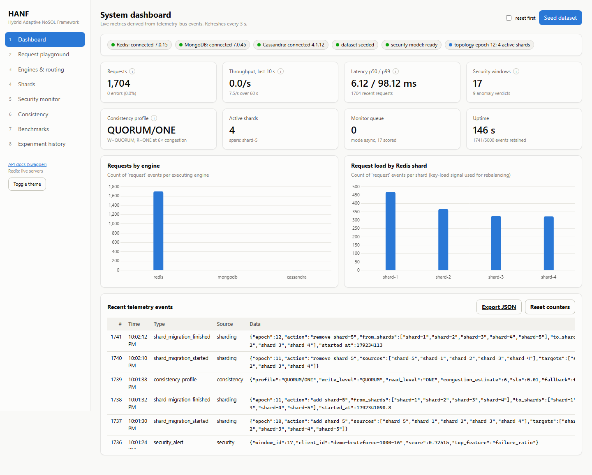
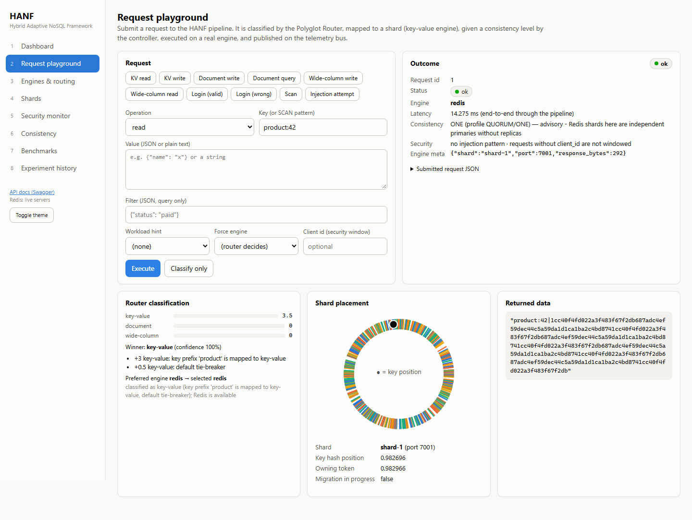
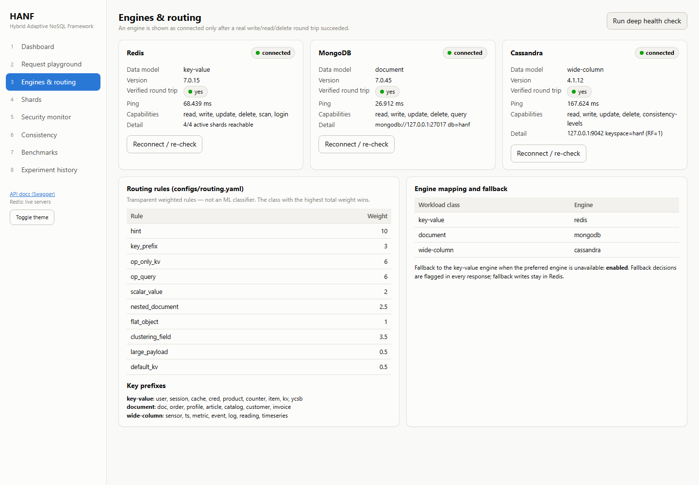
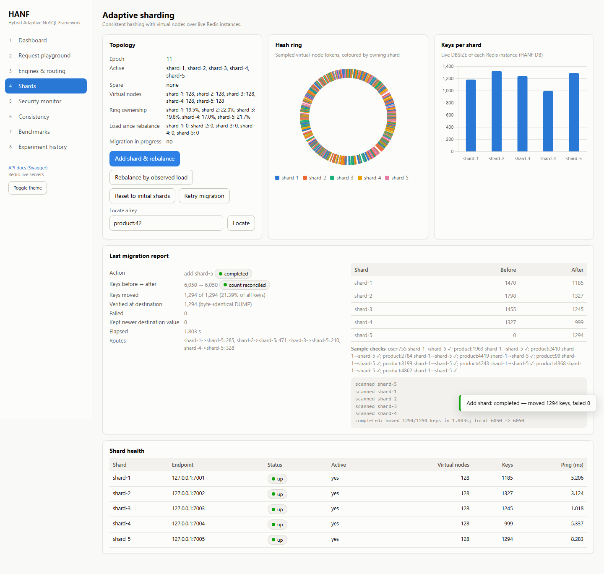
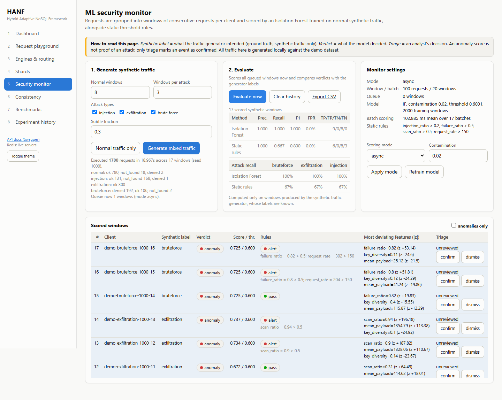
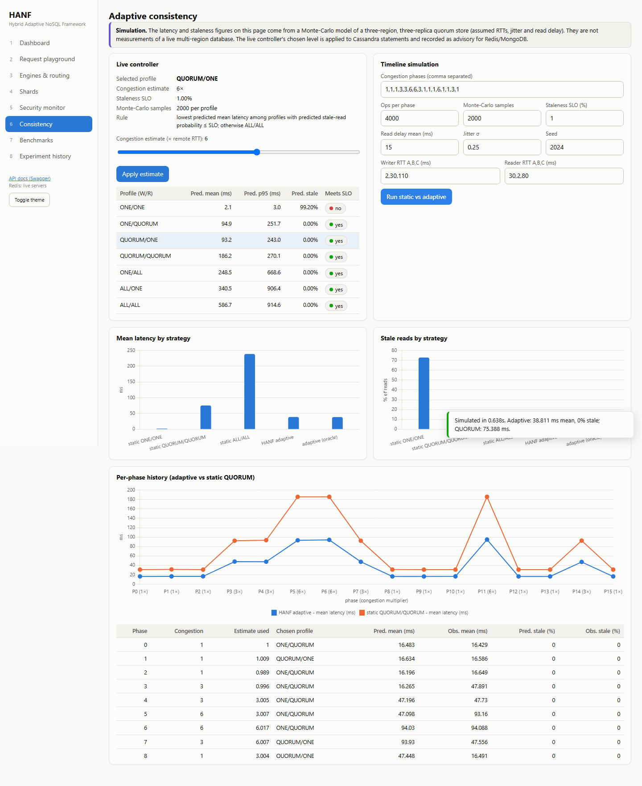
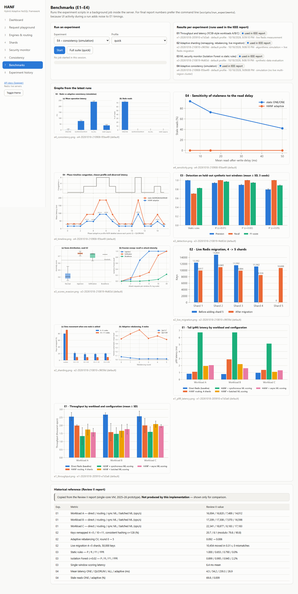
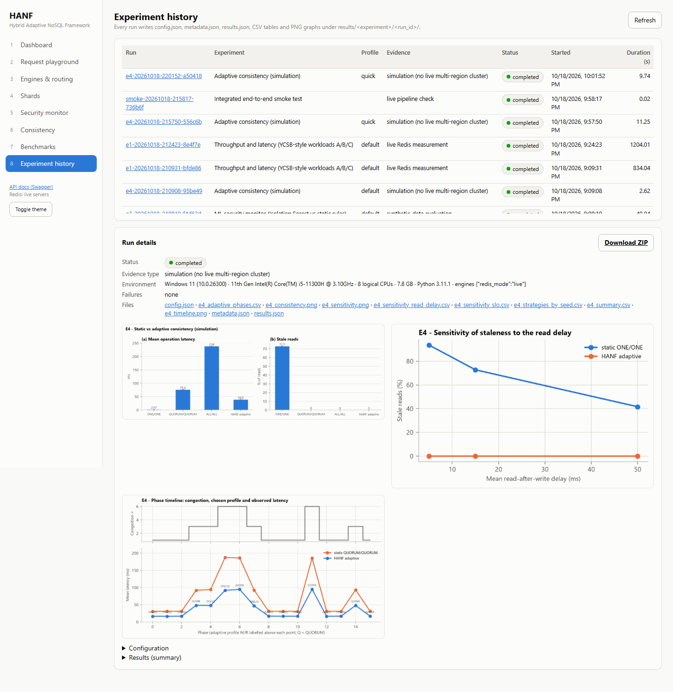

# HANF dashboard — user manual

Open **http://127.0.0.1:8000/** after starting the system ([HOW_TO_RUN.md](HOW_TO_RUN.md)).
The left sidebar has eight pages. Every button calls the real backend; results shown are what the
server returned. Coloured status pills always carry a text label as well (green = good, amber =
warning, red = problem, blue = informational). **Toggle theme** switches light/dark mode.

Screenshots are in [`docs/screenshots/`](screenshots/) (captured by `scripts/ui_check.py`).

---

## 1. Dashboard

* **Health strip** — each engine's status and version, whether the dataset is seeded, whether the
  security model is loaded, and the shard topology epoch. If Redis runs in emulated mode a warning
  pill says so.
* **Seed dataset** — loads the deterministic demo data (tick *reset first* to wipe the HANF Redis DB
  before loading).
* **Tiles** — requests, throughput (last 10 s / 60 s), latency p50/p99, scored security windows and
  anomaly verdicts, the current consistency profile, active shards, monitor queue, uptime. Hover the
  ⓘ icon to see exactly which telemetry events a tile is computed from.
* **Charts** — requests per engine, and request load per Redis shard (the signal used by load-based
  rebalancing).
* **Recent telemetry events** — newest events on the bus. **Export JSON** downloads them;
  **Reset counters** clears the bus.

The page refreshes every 3 seconds.

## 2. Request playground

1. Pick a **preset** (KV read/write, document write/query, wide-column write/read, valid/wrong login,
   scan, injection attempt) or fill the form yourself.
2. Fields: operation, key (or a SCAN pattern such as `product:1*`), value (JSON or plain text),
   filter (JSON, for `query`), optional workload hint, optional forced engine, optional client id
   (requests with a client id are grouped into security windows).
3. **Execute** runs the request; **Classify only** shows the routing decision without executing.

Results:
* **Outcome** — status pill (`ok`, `not_found`, `denied`, `rejected`, `error`), engine (with a
  *fallback* pill if the preferred engine was down), end-to-end latency, the consistency level and
  whether it is applied or advisory for that engine, whether an injection-style pattern was seen,
  and engine metadata. Expand *Submitted request JSON* to see exactly what was sent.
* **Router classification** — score bars for the three workload classes, the winner and confidence,
  and every rule that fired with its weight.
* **Shard placement** — for key-value requests: the hash ring with the key's position (black dot),
  the owning shard and port, and whether a migration is in progress.
* **Returned data** — the actual data returned by the engine.

Try the *Injection attempt* preset: the document engine rejects the `$ne` operator and the status is
`rejected`.

## 3. Engines & routing

One card per engine: status, version, whether a real write/read/delete **round trip** has been
verified, ping time, capabilities and connection detail. **Reconnect / re-check** retries the
connection (use it after starting MongoDB/Cassandra late). **Run deep health check** pings every
engine. Below: the routing rule weights and key-prefix lists from `configs/routing.yaml`, the
class → engine mapping and the fallback policy.

## 4. Shards

* **Topology** — epoch, active and spare shards, virtual nodes per shard, the share of the ring each
  shard owns, request load since the last rebalance, and whether a migration is in progress.
* **Add shard & rebalance** — activates the next spare Redis instance (shard-5), migrates the keys
  whose owner changes and shows the **migration report**: keys moved and verified (byte-identical
  `DUMP`), failures, totals before/after with a *count reconciled* pill, per-route counts, sample
  checks and the log.
* **Rebalance by observed load** — re-weights virtual nodes from the request load seen since the
  last rebalance (needs ≥ 200 requests; generate traffic first) and migrates accordingly.
* **Reset to initial shards** — moves everything back to the four initial shards (use before
  repeating the demo). **Retry migration** finishes a migration that ended `partial`.
* **Locate a key** — shows which shard owns any key and marks it on the ring.
* **Hash ring** — sampled virtual-node tokens coloured by shard. **Keys per shard** — live DBSIZE.
* **Shard health** — endpoint, up/down, active/spare, vnodes, key count, ping.

## 5. Security monitor

Read the banner first: *synthetic label* is the generator's ground truth, *verdict* is the model's
decision, *triage* is a human decision. An anomaly score is not proof of an attack.

1. **Generate synthetic traffic** — choose the number of normal windows, windows per attack type,
   which attack types (injection, exfiltration/large scans, brute-force login) and the fraction of
   *subtle* low-intensity attacks. **Normal traffic only** sends only normal windows. Each window is
   100 requests executed for real through the pipeline against the seeded dataset. The summary shows
   how many requests ran and their real outcomes (e.g. brute-force logins `denied`).
2. **Evaluate now** — scores every queued window immediately and shows precision, recall, F1, false
   positive rate and TP/FP/TN/FN for the Isolation Forest and for the static rules, plus recall per
   attack type. These metrics use only synthetic windows (labels known).
3. **Monitor settings** — scoring mode (`async` background worker, `batched`, `sync`, `off`),
   contamination and **Retrain model**.
4. **Scored windows** — each window's client, synthetic label, verdict, score vs threshold, static
   rule result (and which rule fired), the most deviating features with z-scores, and **confirm /
   dismiss** triage buttons. Tick *anomalies only* to filter. **Export CSV** downloads the table.

## 6. Consistency

The purple banner reminds you that this page is a **simulation**.

* **Live controller** — the profile currently used by the request pipeline. Move the *congestion
  estimate* slider and press **Apply estimate**: the controller re-predicts all seven (W, R)
  profiles and the table highlights the chosen one (lowest predicted latency among profiles whose
  predicted stale probability is within the SLO). The chosen level is applied to Cassandra statements
  and shown as advisory for Redis/MongoDB.
* **Timeline simulation** — set the congestion phases, operations per phase, Monte-Carlo samples,
  SLO, read delay, jitter, seed and the RTTs, then **Run static vs adaptive**. Charts show mean
  latency and stale-read percentage per strategy; the per-phase chart and table show the profile the
  adaptive controller chose in each phase, its prediction and what was observed. *adaptive (oracle)*
  sees the true congestion of each phase and is an upper bound, not a deployable strategy.

## 7. Benchmarks

Choose an experiment (E1–E4 or all) and a profile, press **Start**; progress streams into the log.
Runs one at a time in the background. The right panel lists the latest completed run of each
experiment; below are their graphs. The bottom table holds **historical** values copied from the
Review II report — clearly labelled, not produced by this implementation. For final report numbers
use the command line (UI activity adds noise to E1 timings).

## 8. Experiment history

All runs on disk with experiment, profile, evidence type (live measurement / simulation /
synthetic), status and duration. Click a run id to see its environment (OS, CPU, Python, engine
versions), failures, files (CSV/JSON/PNG links), graphs, configuration and summary results.
**Download ZIP** exports the whole run directory.

## Reading the graphs
* **E1 throughput / p99** — bars per configuration within each workload; error bars are ±1 SD over
  repetitions. Compare HANF configurations with the *Direct Redis* bar of the same workload.
* **E2 (a)** — % of keys moved when one node is added; dotted lines mark the ideal 1/(N+1).
  **(b)** — hottest node load / mean load across rebalancing rounds (1.0 = perfect balance).
* **E3** — precision/recall/F1 with SD over seeds; score distributions with the threshold line; the
  evasion curve shows recall falling as attacks get closer to normal behaviour.
* **E4** — mean latency and stale reads per strategy; the timeline shows congestion, the chosen
  profile and latency per phase.
